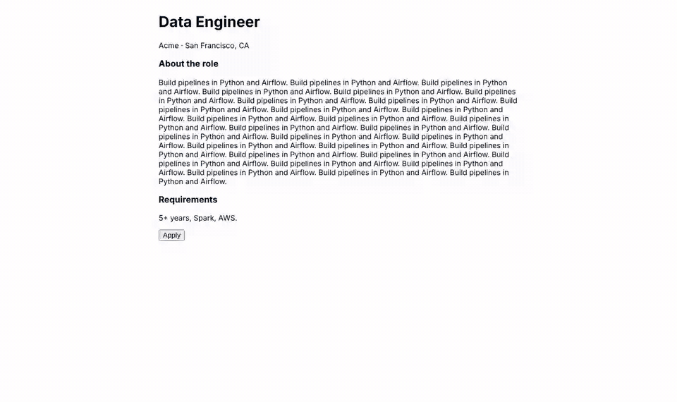
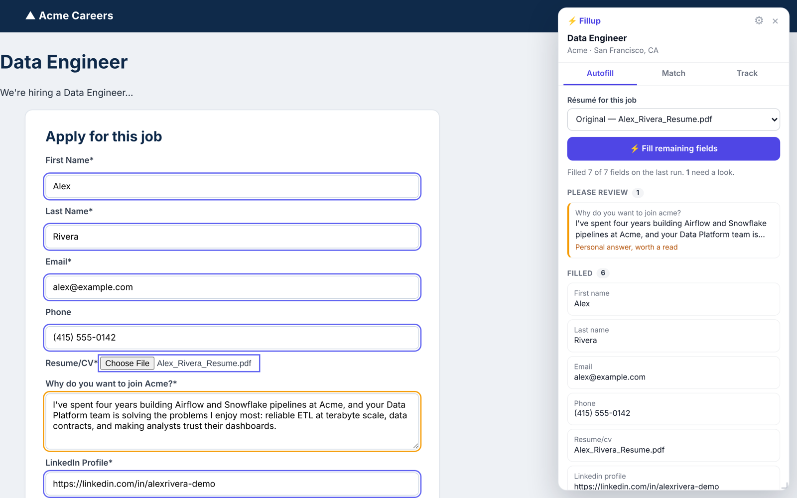
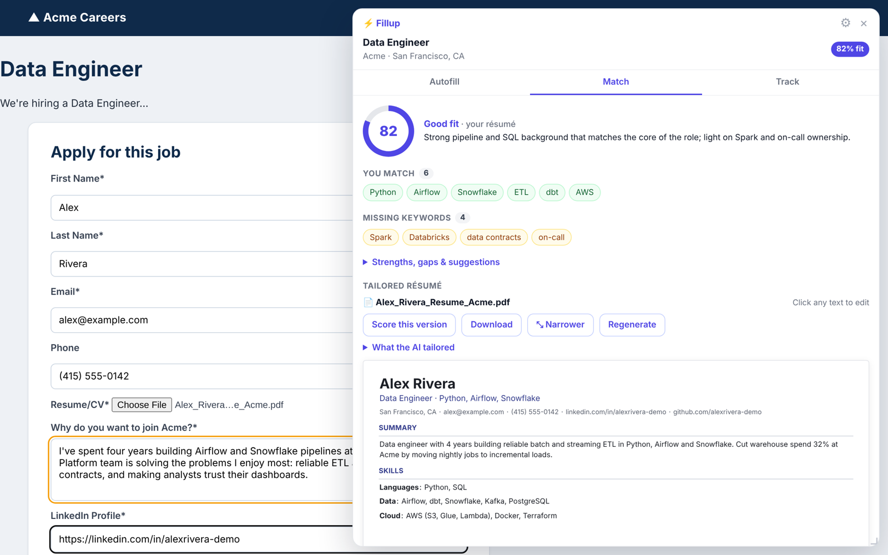
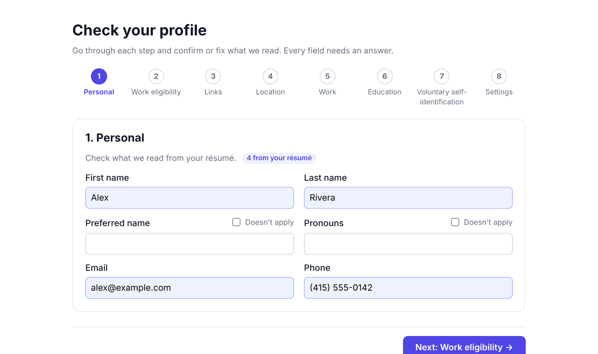
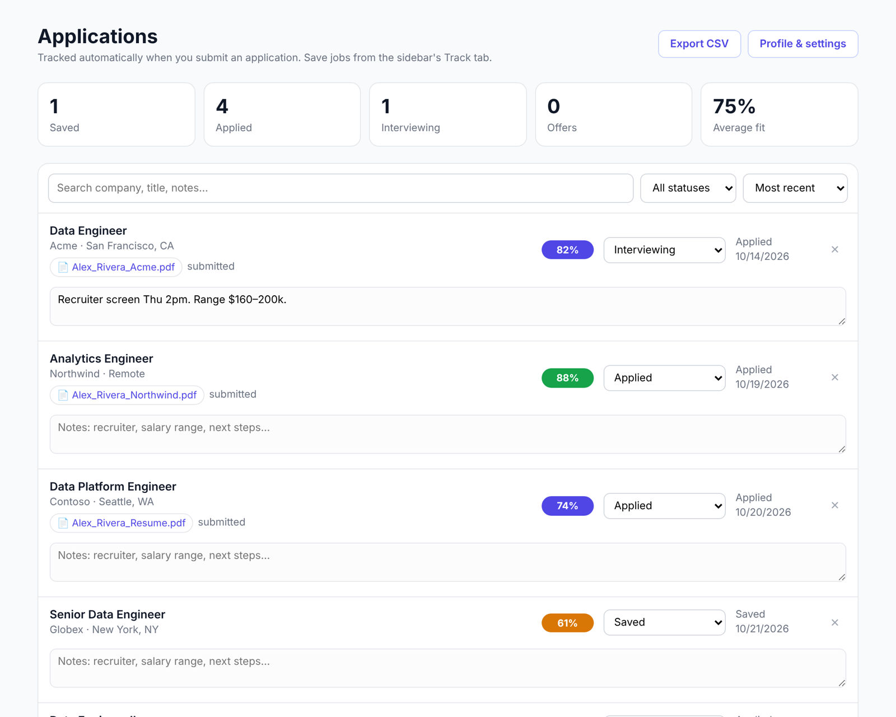

<div align="center">


# Fillup

*The job application that fills itself out.*

**An open-source AI copilot for job applications.** It reads the form like a person would, answers every question from your résumé, fixes what Workday got wrong, and clicks through to the Review page. It never presses Submit. That part is yours.

[](LICENSE)
[](#quick-start)
[](#prerequisites)
[](#pick-your-ai)
[](#contributing)



<sub>Autopilot on a Workday-style application, sped up 2.6×: <b>Apply → Apply Manually → create account → sign in → fill → fix the site's wrong pre-fills → add work history → attach résumé → stop at Review.</b> Eight clicks, zero typing.</sub>

</div>

> [!NOTE]
> **Your data stays on your machine.** Fillup has no servers, no accounts and no analytics. Your résumé, answers and job-site passwords live in your browser. The only thing that ever leaves is the prompt sent to the AI provider *you* choose, with *your* API key. Or point it at Ollama and nothing leaves at all.

---

## Why this exists

Applying to jobs in 2026 means typing the same résumé into a different form two hundred times. Then Workday "parses" your PDF, puts your company name in the job title box and pastes three jobs' worth of bullets into one description, and you get to fix that too.

The existing autofill extensions match field labels to a profile: `First Name` → first name. That handles the first eight fields. It falls apart on the questions that actually take time: *"Describe a time you…"*, *"How many years of Python?"*, a 190-country dropdown, a React combobox, the fifth "Add Another" work-experience block.

Fillup puts an LLM behind every field. It sees the whole form (labels, sections, options, what's already typed) and answers it the way you would, from your résumé and the answers you've given before. If the site pre-filled something wrong, it corrects it.

## What it does

| | |
|---|---|
| 🧠 **AI fills every field** | No label matching. Text, textareas, selects, radios, checkboxes, React comboboxes, Workday listboxes, and file uploads. Sends the AI the question, the section ("Work Experience 2 of 3") and the options, then picks real values. |
| 🛠️ **Fixes bad pre-fills** | Workday mangled your job descriptions? Fillup overwrites them with the real ones from your résumé, and tells you what it changed (`Corrected · was: Acme Corp`). |
| 🤖 **Autopilot** | Opens a job posting → clicks Apply → picks "Apply Manually" → creates an account or signs in → fills each page → clicks Next → **stops at Review.** |
| 🔐 **Account vault** | Generates a strong unique password per job site and stores it encrypted (AES-GCM, non-extractable key) in your browser. Passwords are **never** sent to the AI; it only sees a `{{PASSWORD}}` placeholder. |
| 📈 **Fit score** | 0–100 match against the posting, matched skills, missing keywords, gaps, and what to fix. |
| ✍️ **Tailored résumé, edited live** | One click rewrites your résumé for this job (no invented experience). Edit it right in the sidebar like a doc; it re-renders the PDF and swaps it into the upload field. |
| 🧾 **Remembers what you submitted** | Saves the exact PDF you sent to each company. Six weeks later, when the recruiter calls, you know which version they're holding. |
| 🧠 **Learns your answers** | Every answer you type or correct goes into a local answer memory and gets reused next time. |
| 📋 **Tracker** | Every submitted application lands in a tracker with status, fit, notes, the files you sent, CSV export, and one-click LinkedIn + Apollo searches for the hiring manager and your connections at the company. |
| 💸 **Cheap on tokens** | Sends your extracted work history instead of your whole résumé, only includes the job description for open-ended questions, and trims 190-option dropdowns before they reach the model. |

<table>
<tr>
<td width="50%"><br><sub><b>Autofill.</b> Everything filled; the one personal answer is flagged for a read.</sub></td>
<td width="50%"><br><sub><b>Match.</b> Fit score, missing keywords, and a tailored résumé you edit in place.</sub></td>
</tr>
<tr>
<td><br><sub><b>Setup.</b> Drop in your résumé; confirm what it read in 8 short steps.</sub></td>
<td><br><sub><b>Tracker.</b> Status, fit, notes, and the exact file you sent.</sub></td>
</tr>
</table>

---

## How it works

```
 ┌──────────────── your browser ─────────────────┐        ┌──── your machine ────┐        ┌──── your choice ────┐
 │                                               │        │                      │        │                     │
 │  job page ──► content script reads the form   │        │   Fillup server      │        │  Claude · OpenAI    │
 │               (labels, sections, options,     │ ─────► │   localhost:8787     │ ─────► │  Groq · DeepSeek    │
 │                what's already filled)         │        │   builds the prompt, │        │  Ollama (offline)   │
 │                                               │ ◄───── │   validates JSON     │ ◄───── │                     │
 │  fills fields, clicks Next, never Submit  ◄── │        │                      │        │                     │
 │                                               │        └──────────────────────┘        └─────────────────────┘
 │  résumé · answers · passwords (encrypted) ── stored here, in chrome.storage                                   │
 └───────────────────────────────────────────────┘
```

Two pieces:

1. **`extension/`**: a Chrome extension (Manifest V3, plain JS, no build step). It's the eyes and hands: finds the form, reads it, types into it, clicks.
2. **`server/`**: a tiny Node server on `localhost` (two dependencies, no framework). It's the brain: turns a form into a prompt, calls your AI, and returns strict JSON. It runs locally so your API key never touches a web page.

---

## Prerequisites

- **Google Chrome** (or Edge, Brave, Arc: anything Chromium)
- **Node.js 18+**: check with `node -v`
- **An API key from one AI provider.** Any of these works:

| Provider | Why pick it | Default model |
|---|---|---|
| **DeepSeek** | Cheapest. Very good for the price. | `deepseek-flash` |
| **Groq** | Fastest; has a free tier. | `openai/gpt-oss-120b` |
| **Anthropic** | Best quality on long, open-ended answers. | `claude-sonnet-5-5` |
| **OpenAI** | Strong all-rounder. | `gpt-6.1-sol` |
| **Ollama / LM Studio / OpenRouter** | Any OpenAI-compatible endpoint. Ollama = fully offline. | your pick |

> [!TIP]
> **What it costs.** In our end-to-end test, a full 4-page Workday-style application (posting → account → 3 form pages) used about **15k input tokens** in total, including the fit score. On DeepSeek or Groq that's well under a cent. On a frontier model it's a few cents. Tailoring a résumé is one more call. Check your provider's current pricing.

---

## Quick start

**1. Get the code**

```bash
git clone https://github.com/captain737/job-autofill-extension.git
cd job-autofill-extension/server
npm install
```

**2. Add your API key**

```bash
cp .env.example .env
```

Open `server/.env` and uncomment **one** line, e.g.

```bash
GROQ_API_KEY=gsk_your_key_here
```

> [!IMPORTANT]
> `.env` is in `.gitignore`. Never commit it, and never paste your key into the extension or a web page. Only the local server reads it.

**3. Start the brain**

```bash
npm start
```

You should see `Fillup backend on http://127.0.0.1:8787 using groq / openai/gpt-oss-120b`. Leave this terminal open while you apply; closing it turns the AI off.

**4. Load the extension**

1. Go to `chrome://extensions`
2. Turn on **Developer mode** (top right)
3. Click **Load unpacked** and pick the **`job-autofill-extension/extension`** folder
4. Pin ⚡ Fillup to your toolbar

**5. Set up your profile**

The setup page opens automatically. Drop in your résumé (PDF, DOCX or TXT). Fillup extracts everything (contact info, every job with its full description, education, skills, projects, certifications), then walks you through 8 short steps to confirm it: Personal → Work eligibility → Links → Location → Work → Education → Self-identification → Settings.

**6. Try it safely first**

Open [`demo/multi-step-workday-style.html`](demo/multi-step-workday-style.html) in Chrome. It's a fake careers site, so you can watch autopilot work without applying to anything. (For local files, open the extension's **Details** page and turn on **Allow access to file URLs**.)

**7. Apply for real**

Open any job posting. The sidebar slides in, scores the job, and starts. Toggle it any time with **`Alt+Shift+J`** (change it at `chrome://extensions/shortcuts`).

---

## Autopilot: what it will and won't do

Autopilot turns on when you open a job posting or application on a company site or applicant-tracking system (Workday, Greenhouse, Lever, Ashby, iCIMS, SmartRecruiters, Taleo and more). Each step, the AI looks at the page and picks the next button. Then the extension double-checks that choice in code before clicking.

**It will:**
- Click **Apply**, **Apply Manually**, **Next**, **Save and Continue**, **Add Another**
- Create an account with a unique strong password, or sign in with a saved one
- Fill every page, attach the right résumé, and expand repeating sections for each job and school

**It will never**, whatever the AI says:
- Press **Submit**, Send, Finish, Confirm, Withdraw, Delete, or Sign out. These are hard-blocked by a regex in [`content/core.js`](extension/content/core.js), not by a prompt. We tested this by giving it a model that *tries* to click Submit, and it refuses.
- Tick "I agree to the terms" for you, unless you turn that on in Settings
- Solve CAPTCHAs, click email verification links, or guess at required questions it can't answer. It stops, highlights the field, and tells you.
- Run on LinkedIn, Indeed, Glassdoor, ZipRecruiter or other job boards. It waits for you to land on the company's own application.

When it reaches Review, it stops and shows **Ready to submit**. You read it, then you click Submit.

---

## Settings

All in the extension's **Profile & settings** page.

| Setting | Default | What it does |
|---|---|---|
| Autopilot | on | Click through applications up to Review |
| Create accounts automatically | on | Generate and save a password per job site |
| Tick "I agree to the terms" | **off** | Let autopilot accept a site's account terms for you |
| Open sidebar automatically | on | Slide in on application forms |
| Autofill as soon as detected | on | Start filling without a click |
| Let the AI correct pre-filled fields | on | Overwrite what the site guessed from your résumé |
| Score every posting | off | One AI call per posting you open; otherwise it scores when you open Match |
| Backend URL | `http://localhost:8787` | Point at a different machine or port |

**Server options** (`server/.env`): `MODEL` to change the model, `PROVIDER=custom` + `LLM_BASE_URL` for any OpenAI-compatible API, `PORT`, and `JSON_MODE=object` for models without JSON-schema support.

```bash
# Fully offline with Ollama
PROVIDER=custom
LLM_BASE_URL=http://localhost:11434/v1
MODEL=llama3.1
```

---

## Tips

- **Upload your most detailed résumé.** Fillup can only answer from what it knows. Long bullet lists are good; it'll pick what's relevant per field.
- **Answer the weird questions once.** Every edit you make before submitting is saved to answer memory, so it gets better each application.
- **Multiple résumés?** Upload them all (Profile → Résumés) and pick per job in the sidebar.
- **Check the 🟧 orange fields.** Those are personal or judgment answers ("Why us?"). The AI drafts them; you're the one who sends them.
- **Drag the sidebar** by its header, resize from the corner, double-click to dock. Press ⤢ in Match for a wide résumé editor.
- **Find the hiring manager.** The Track tab links straight to LinkedIn and Apollo searches for the team's manager, recruiters, and your connections at the company.

---

## Project layout

```
job-autofill-extension/
├── extension/            Chrome extension (no build step)
│   ├── manifest.json
│   ├── background.js     service worker: talks to the server, tracker, vault, answer memory
│   ├── content/
│   │   ├── core.js       reads forms, fills fields, finds buttons, safety rules
│   │   ├── sidebar.js    the sidebar UI (shadow DOM, draggable, resizable)
│   │   └── main.js       autofill, autopilot, fit score, tailoring, tracking
│   ├── options.*  wizard.js   setup wizard, profile, résumés, answer memory, accounts
│   ├── tracker.*         application tracker
│   └── popup.*           toolbar popup
├── server/
│   ├── server.js         HTTP server, providers, prompts for parse / fill
│   ├── features.js       fit analysis, tailoring, résumé PDF, autopilot navigation
│   └── .env.example
├── demo/                 fake careers sites for trying it out safely
└── docs/                 images for this README
```

---

## FAQ

**Is this allowed?**
Fillup fills forms and clicks buttons you could click yourself, and a human (you) always submits. Some sites' terms restrict automated tools, so read them for the sites you use. Use it to apply faster and better to jobs you actually want, not to spam.

**Will companies know?**
Fillup types into the page the same way a browser autofill does. It doesn't hide anything, either: read what it wrote before you submit.

**Does it make things up?**
The prompts forbid inventing experience, and fill answers come only from your résumé, profile and saved answers. If it doesn't know, it leaves the field for you and says why. Personal answers are flagged for review. LLMs still make mistakes, which is exactly why it stops before Submit.

**Can I run it without a terminal?**
Not yet. A hosted option where you paste your own key is on the roadmap.

**Firefox / Safari?**
Not yet. PRs welcome.

---

## Roadmap

- [ ] Chrome Web Store release
- [ ] One-click setup (no terminal)
- [ ] Cover letter generator
- [ ] Firefox support
- [ ] Interview-prep notes per tracked application

## Contributing

Issues and PRs are welcome. The most useful contribution: **a form it gets wrong.** Open an issue with the site (ATS name is enough), the field, and what it did. If you can, save the page and reduce it to a small HTML file like the ones in [`demo/`](demo/).

To hack on it: edit files in `extension/`, then hit ↻ on the extension card in `chrome://extensions`. The server restarts with `npm start`. No build step anywhere.

## Responsible use

Fillup is a tool for applying to jobs you're qualified for and interested in, faster. Please don't use it to mass-apply to roles you haven't read. It never submits for you on purpose: every application that goes out should be one you looked at.

## License

[MIT](LICENSE). Do what you want; a ⭐ is appreciated.

<div align="center"><sub>Built because job hunting is hard enough without typing your résumé into Workday 200 times.</sub></div>
